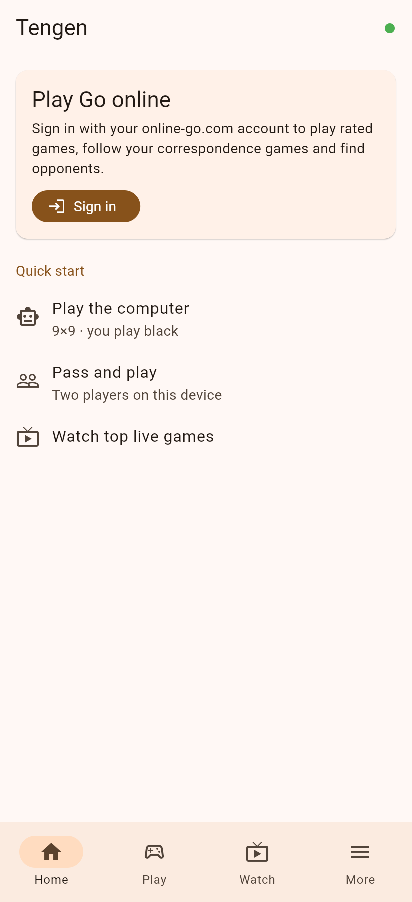
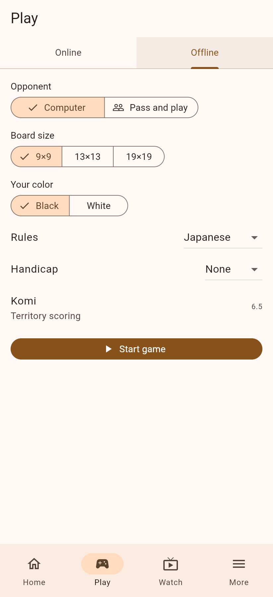
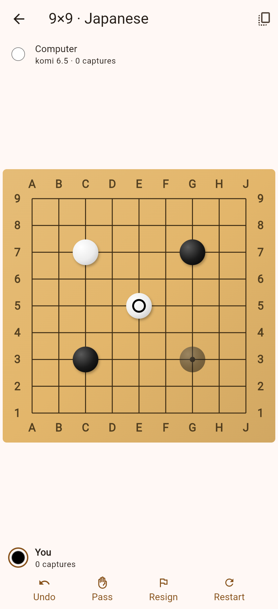

# Tengen

An open source Flutter app to play Go (baduk, weiqi) on [online-go.com](https://online-go.com)
and offline.

Tengen started as a fork of the [Lichess mobile app](https://github.com/lichess-org/mobile): it
keeps its architecture (Riverpod state, model/view/widgets layering, one navigator per tab,
full-screen game routes, strict analysis rules) and replaces chess with Go. Online play is built
on the APIs used by the [online-go.com web client](https://github.com/online-go/online-go.com)
and its [goban](https://github.com/online-go/goban) library.

This is an unofficial client, not affiliated with OGS or Lichess.

<p>
  
  
  
</p>

## Features

- **Offline games** against a small built-in bot, or pass and play, on 9×9, 13×13 and 19×19, with
  Japanese, Chinese, AGA, Korean, New Zealand and Ing rules, handicap, undo, counting with dead
  stone marking, and SGF export.
- **OGS account**: sign in with your online-go.com username and password, see your ongoing games
  with the ones waiting for your move first.
- **Online play**: automatch (quick match by board size and speed), playing moves, passing,
  resigning, undo requests, stone removal and result, live clocks (Fischer, byo-yomi, Canadian,
  simple, absolute) corrected for clock drift.
- **Watch**: top live and correspondence games on OGS, updated in real time.
- **Player profiles** with recent games.
- Board themes, coordinates, tap-twice move confirmation, light and dark themes.

## Development

Requires Flutter 3.50 (Dart 3.14).

```bash
flutter pub get
flutter run                       # Android, iOS, Linux or web
flutter test                      # unit and widget tests
flutter analyze && dart format lib test
```

Use another OGS server (e.g. the beta site):

```bash
flutter run --dart-define=OGS_HOST=beta.online-go.com
```

`test/live/` holds a test that replays real games from online-go.com through the rules engine
and compares capture counts with the server's scores. It is skipped by default:

```bash
flutter test -t live --run-skipped
```

## Architecture

```
lib/src/
├── model/
│   ├── go/            # Rules engine: board, game, rule sets, scoring, coordinates, SGF, bot
│   ├── ogs/           # OGS data (game data, clocks, users), repository, socket provider
│   ├── online_game/   # Online game and automatch controllers
│   ├── offline_game/  # Offline game controller
│   ├── auth/          # OGS session
│   └── settings/      # Preferences
├── network/           # REST client (session cookies + CSRF) and realtime socket
├── view/              # Screens, by feature (home, play, watch, more, games, profile)
├── widgets/           # Board, player bars and clocks, game layout
└── tab_scaffold.dart  # Bottom tabs, one navigator per tab
```

How the OGS integration works:

- **Authentication** mirrors the website: `GET /api/v1/ui/config` for a CSRF cookie, then
  `POST /api/v0/login`. The Django `sessionid` and `csrftoken` cookies are kept in secure
  storage. `ui/config` returns the `user_jwt` used to authenticate the realtime socket (guests
  get one too, so watching works without an account). Accounts that only use a social login need
  to set a password on OGS first.
- **Realtime** (`network/socket.dart`) is a port of goban's `GobanSocket`: JSON arrays
  `[command, data, id?]`, replies matched by id, `net/ping` every 10 s to measure latency and
  clock drift, automatic reconnection with backoff, authentication replayed on every connection.
- **Games** (`model/online_game/`) send `game/connect`, build the board from `gamedata` and apply
  `move`, `clock`, `phase`, `removed_stones` and `undo_*` events. A missed move triggers a
  resynchronisation. Moves from the server are applied without validation (the server is
  authoritative); local validation only guards the user's own taps.

## License

GPL-3.0-or-later, see [COPYING.md](COPYING.md) and [LICENSE](LICENSE).
